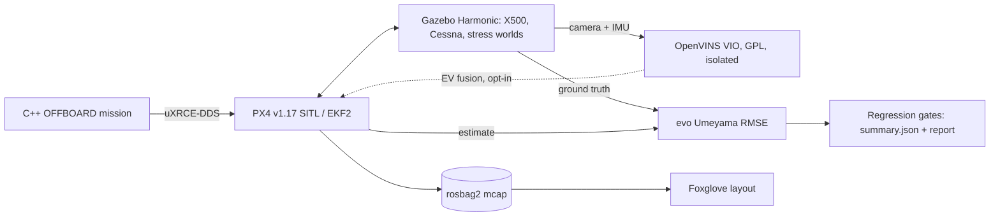

<!-- GitHub appearance fragments (not OS prefers-color-scheme): a light
     GitHub session still gets the navy wordmark when the OS is dark. -->
<p align="center">
  
  
</p>

<h3 align="center">From git clone to a scored autonomous flight in one command.</h3>

<p align="center">
<strong>Scored, not just simulated.</strong> A current PX4 v1.17 + ROS 2 Jazzy + Gazebo Harmonic SITL stack with Umeyama RMSE gates, VIO stress worlds, and repeatable regression from one Docker image. Software-in-the-loop only, not flight-certified.
</p>

<p align="center">
<a href="https://github.com/palcode/opendronelab/actions/workflows/ci.yml"></a>
<a href="LICENSE"></a>


<a href="https://palcode.github.io/opendronelab"></a>
<a href="ROADMAP.md"></a>
<a href="https://github.com/palcode/opendronelab/labels/good%20first%20issue"></a>
<a href="https://github.com/palcode/opendronelab/discussions"></a>
</p>

<p align="center">
  
</p>

- **Scored, not just simulated.** Every official flight is graded against Gazebo ground truth (evo Umeyama RMSE) with regression gates that fail loudly.
- **Current stack, in Docker.** PX4 v1.17 SITL, ROS 2 Jazzy, and Gazebo Harmonic in one development image, a C++ OFFBOARD node, optional OpenVINS VIO, and VIO stress worlds.
- **Sim-first, not flight-certified.** The same launch files are meant to grow toward a real airframe, with a [readiness checklist](docs/real-drone-readiness.md). The verified path today is software-in-the-loop and must not be used to operate a real aircraft without separate safety, legal, and range review.

## Quickstart

### Try it without SITL: view the v0.1.0 sample bag in Foxglove

No Docker build or SITL required. Download the `odl-v0.1.0-mc_gps-sample.mcap` bag (about 10 seconds, 294 KB) and example report from the [v0.1.0 release](https://github.com/palcode/opendronelab/releases/tag/v0.1.0). Open it in [Foxglove](https://foxglove.dev/download) with the in-tree layout to see ground truth and EKF2 paths from a passing `mc_gps` flight. Full walkthrough: [docs/QUICKSTART-sample.md](docs/QUICKSTART-sample.md).

### Full SITL setup: build locally and run scored regression

Build the development image locally from `docker/Dockerfile.dev`. There is no hosted image; a published GHCR image is not planned.

The repository root is `ODL_ROOT`. Runtime data (bags, PX4 overlays, results) lives in a sibling `dronelab-data` directory (`ODL_DATA`), not in git. Scripts default both from the checkout: a clone at `…/opendronelab` uses `…/dronelab-data`. There is no `./odl` wrapper yet; use the commands below.

```bash
git clone https://github.com/palcode/opendronelab.git
cd opendronelab
export ODL_ROOT="$PWD"
export ODL_DATA="$(cd "$ODL_ROOT/.." && pwd)/dronelab-data"
mkdir -p "$ODL_DATA"

# One-time: build the development image (NVIDIA Container Toolkit recommended).
# Skip this if `opendronelab-dev:latest` is already present on the host.
docker build -t opendronelab-dev:latest \
  --build-arg USER_UID="$(id -u)" --build-arg USER_GID="$(id -g)" \
  -f docker/Dockerfile.dev docker/

# One-time: build ROS 2 packages into $ODL_DATA (px4_msgs + first-party
# packages). Required before pytest. This is not an image rebuild.
# Skip if $ODL_DATA/ros2_build/ws/install/setup.bash already exists.
docker run --rm \
  -v "$ODL_ROOT":/workspace -v "$ODL_DATA":/data \
  -u "$(id -u):$(id -g)" -e HOME=/tmp -w /workspace \
  opendronelab-dev:latest \
  /workspace/scripts/build-workspace.sh

# Headless unit tests (no GPU).
SCENARIOS=pytest ./scripts/run-regression.sh
```

`scripts/odl-env.sh` is sourced by the launch and regression scripts, so you can omit the `export` lines if you are happy with those defaults.

Expected pytest output (example from a 2026-11-14 run on this tree):

```text
93 passed, 3 warnings in 3.08s
[REG] pytest: PASS (93/31)
```

A scored SITL suite needs an NVIDIA GPU and takes longer:

```bash
HEADLESS=1 ./scripts/run-regression.sh
```

Documented `mc_gps` result (N=5, 2026-11-13, official EKF2 Umeyama xy, gate 0.39 m):

```text
scenario  metric             result     gate     status
mc_gps    EKF2 Umeyama xy    0.257 m    0.39 m   PASS   (mean 0.2572 ± 0.0022 m, pass@1 5/5)
```

Host and day-to-day SITL notes: [docs/setup-host.md](docs/setup-host.md), [docs/compatibility-matrix.md](docs/compatibility-matrix.md), [docs/simulation-guide.md](docs/simulation-guide.md).

## Who it's for

- PX4 and ROS 2 users who want a **current, scored** SITL lab rather than a one-off demo world.
- People coming from older ROS 1 or AirSim stacks who want a maintained PX4-native path (Gazebo Harmonic, uXRCE-DDS, official Umeyama gates).
- Researchers who need repeatable VIO and GPS baselines, mcap bags, and a Foxglove layout — not photorealism claims.

## Benchmarks

Official scored metric: a global [evo](https://github.com/MichaelGrupp/evo) Umeyama fit of the estimator against Gazebo ground truth (xy / 3D RMSE, metres). GPS remains the default (`EKF2_EV_CTRL=0`); OpenVINS is scored in shadow unless vision fusion is opted in. Gates live in `config/regression_thresholds.yaml` and must not be loosened silently.

Four gating scenarios (documented calibration and check flights):

| Scenario | Vehicle | Official metric | Gate (m) | Documented result |
|----------|---------|-----------------|----------|-------------------|
| `baseline` | `gz_x500_mono_cam` | VIO / EKF2 Umeyama xy | VIO 0.70, EKF2 0.40 | 2026-11-13 check: EKF2 xy 0.258 m, VIO xy 0.445 m |
| `faster_motion` | `gz_x500_mono_cam` | VIO Umeyama xy | 0.42 | Gate from the 2026-11-09 calibration |
| `wind` | `gz_x500_mono_cam` | VIO Umeyama xy | 1.85 | Gate from the 2026-11-09 calibration (includes gusts) |
| `mc_gps` | `gz_x500` (GPS only) | EKF2 Umeyama xy | 0.39 | N=5 on 2026-11-13: mean 0.2572 ± 0.0022 m, pass@1 5/5 |

`low_texture` is scored but **non-gating** (known limitation, VIO gates 0.55 / 0.56 m). `faster_motion_aggressive` and `fw_mission` (`gz_rc_cessna`) are opt-in / reported only; fixed-wing has no official gate yet. Baseline VIO can still jump on the far side of the square — see [ROADMAP.md](ROADMAP.md) (ODL-86). Full tables: [docs/simulation-guide.md](docs/simulation-guide.md), [docs/localization.md](docs/localization.md).

## Features

- **C++ OFFBOARD square flight** as the production mission path, with VIO init hold and retry.
- **OpenVINS in shadow** (GPL-3, isolated). Vision fusion into EKF2 is opt-in.
- **Stress worlds** (`low_texture`, `faster_motion`, `wind`) and a shared propeller-blade mask on the x500 forward camera.
- **rosbag2 / mcap** recording and a Foxglove layout for replay. Raw camera and OpenVINS track topics are opt-in (`RECORD_CAMERA=1`, `RECORD_OV_FEATURES=1`).
- **Airframes:** `gz_x500` / `gz_x500_mono_cam` are the gating vehicles; stock `gz_rc_cessna` is opt-in and non-gating. VTOL and rover are planned, not started.

## Architecture

<p align="center">
  
</p>

The editable source is [docs/architecture.excalidraw](docs/architecture.excalidraw). Teal marks ground truth; orange marks the opt-in EV fusion path and regression gates.

<details>
<summary>Mermaid source (same topology)</summary>



</details>

Details: [docs/architecture.md](docs/architecture.md).

## Requirements

- Linux host with Docker. An NVIDIA GPU and the NVIDIA Container Toolkit are required for scored SITL flights; the headless pytest path does not need a GPU.
- The development image is Ubuntu 24.04 with PX4 v1.17, Gazebo Harmonic, ROS 2 Jazzy, and Micro XRCE-DDS Agent. Build it locally from `docker/Dockerfile.dev` (see Quickstart). A hosted GHCR image is not planned.
- QGroundControl runs as a native host AppImage when you need a GCS.

Host, GPU, and stack pins: [docs/compatibility-matrix.md](docs/compatibility-matrix.md).

## Docs and tutorials

- [Simulation guide](docs/simulation-guide.md) — day-to-day SITL and the regression suite
- [Localization](docs/localization.md) — EKF2, OpenVINS, Umeyama metrics
- [Bag review](docs/bag-review.md) — mcap and Foxglove
- [Architecture](docs/architecture.md) and [compatibility matrix](docs/compatibility-matrix.md)
- [Real-drone readiness](docs/real-drone-readiness.md) — checklist only, no flight claims
- [Setup](docs/setup-host.md), [official image](docs/official-image.md), [rollback](docs/rollback.md)
- [Sample bag in Foxglove](docs/QUICKSTART-sample.md) and [v0.1.0 release notes](docs/release-notes/v0.1.0.md)
- [NVIDIA redistribution](docs/NVIDIA_REDISTRIBUTION.md) — CUDA/cuDNN wheels and the CPU/base image option

A Zensical docs site is live at <https://palcode.github.io/opendronelab>. These Markdown guides remain the source of truth.

## Roadmap

We are building in public. **Now:** VIO robustness (ODL-86). **Next:** fixed-wing gates and a real-hardware testing path. **Later:** more airframes, a one-command wrapper around the local Docker build, and hardware footage only after a named airframe is flown safely.

See [ROADMAP.md](ROADMAP.md) and issues labelled
[roadmap](https://github.com/palcode/opendronelab/labels/roadmap).

## Community and contributing

Contributions are welcome under [CONTRIBUTING.md](CONTRIBUTING.md) and the [Code of Conduct](CODE_OF_CONDUCT.md). A signed [Contributor License Agreement](CLA.md) is required (Harmony HA-CLA-I v1.0, outbound Option Five).

Start with [good first issues](https://github.com/palcode/opendronelab/labels/good%20first%20issue). Please use the issue and pull request templates. Do not loosen regression gates. Do not add secrets or personal host paths.

[Discussions](https://github.com/palcode/opendronelab/discussions) are open for Q&A, ideas, and show-and-tell. See the [welcome post](https://github.com/palcode/opendronelab/discussions/32).

Automated agents working in this repository must follow [AGENTS.md](https://github.com/palcode/opendronelab/blob/main/docs/AGENTS.md).

## Safety and limitations

This project is **sim-first and not flight-certified**.

- The verified path is SITL. SITL numbers are not a flight certification.
- Hardware bring-up is deferred. See [docs/real-drone-readiness.md](docs/real-drone-readiness.md): safety, legal, and range review, a manual override, and validated failsafes are required; placeholders only until an airframe is named.
- Security reports: [SECURITY.md](SECURITY.md) (GitHub private vulnerability reporting is enabled).

## License

First-party code is licensed under the GNU Affero General Public License v3.0 only ([AGPL-3.0-only](LICENSE)). Third-party notices: [THIRD_PARTY_NOTICES.md](THIRD_PARTY_NOTICES.md).

Commercial licenses are available from Pallab Sarkar at [mailme.pallabsarkar@gmail.com](mailto:mailme.pallabsarkar@gmail.com) or via [https://github.com/palcode](https://github.com/palcode). See [COMMERCIAL-LICENSING.md](COMMERCIAL-LICENSING.md).

## Contact

Pallab Sarkar — [mailme.pallabsarkar@gmail.com](mailto:mailme.pallabsarkar@gmail.com), [https://github.com/palcode](https://github.com/palcode).

## Acknowledgements

Built on PX4, ROS 2, and Gazebo, with optional OpenVINS for visual-inertial odometry, evo for trajectory metrics, and MCAP / Foxglove for bag review. Their names appear here in text only; this project does not use those projects' logos.
