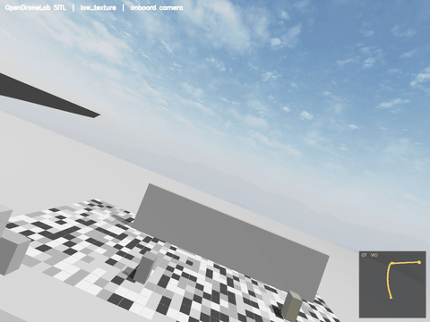

# OpenDroneLab

<picture>
  <source media="(prefers-color-scheme: dark)" srcset="docs/media/logo-dark.svg">
  
</picture>

[](https://github.com/palcode/opendronelab/actions/workflows/ci.yml)
[](LICENSE)


[](docs/)


OpenDroneLab is a simulation-first research stack for PX4 SITL: Gazebo Harmonic, ROS 2 Jazzy, and optional OpenVINS visual-inertial odometry, with a scored regression suite.

The verified path today is software-in-the-loop. This project is **not flight-certified** and must not be used to operate a real aircraft without separate safety, legal, and range review. See [docs/real-drone-readiness.md](docs/real-drone-readiness.md).

First-party code is licensed under [AGPL-3.0-only](LICENSE). Commercial licenses are available; see [COMMERCIAL-LICENSING.md](COMMERCIAL-LICENSING.md).

## Demo



*About 10 s of the onboard camera on the `low_texture` SITL world, with a ground-truth / OpenVINS path inset (Umeyama-aligned). See [docs/media/README.md](docs/media/README.md).*

## Quickstart

The repository root is `ODL_ROOT`. Runtime data (bags, PX4 overlays, results) lives in a sibling `dronelab-data` directory (`ODL_DATA`), not in git. Scripts default both from the checkout location, so on a clone at `.../opendronelab` the data dir is `.../dronelab-data`.

```bash
git clone https://github.com/palcode/opendronelab.git
cd opendronelab
export ODL_ROOT="$PWD"
export ODL_DATA="$(cd "$ODL_ROOT/.." && pwd)/dronelab-data"
mkdir -p "$ODL_DATA"

# One-time: build the development image (NVIDIA Container Toolkit recommended).
# Skip this if `opendronelab-dev:latest` is already present on the host.
docker build -t opendronelab-dev:latest \
  --build-arg USER_UID="$(id -u)" --build-arg USER_GID="$(id -g)" \
  -f docker/Dockerfile.dev docker/

# One-time: build ROS 2 packages into $ODL_DATA (px4_msgs + first-party
# packages). Required before pytest. This is not an image rebuild.
# Skip if $ODL_DATA/ros2_build/ws/install/setup.bash already exists.
docker run --rm \
  -v "$ODL_ROOT":/workspace -v "$ODL_DATA":/data \
  -u "$(id -u):$(id -g)" -e HOME=/tmp -w /workspace \
  opendronelab-dev:latest \
  /workspace/scripts/build-workspace.sh

# One command: headless unit tests (no GPU flights).
SCENARIOS=pytest ./scripts/run-regression.sh
```

The HTTPS clone URL works once the repository is public. While it is private, clone with SSH if you have access.

`scripts/odl-env.sh` is sourced by the launch and regression scripts, so you can omit the `export` lines if you are happy with those defaults. If you do export `ODL_DATA`, it takes precedence over a leftover `DATA_DIR` in the environment. To fly the scored SITL suite (GPU, takes a while):

```bash
HEADLESS=1 ./scripts/run-regression.sh
```

Host setup and hardware notes: [docs/setup-host.md](docs/setup-host.md), [docs/compatibility-matrix.md](docs/compatibility-matrix.md). Day-to-day SITL: [docs/simulation-guide.md](docs/simulation-guide.md).

## Benchmarks

Official scored metric: a global [evo](https://github.com/MichaelGrupp/evo) Umeyama fit of the estimator against Gazebo ground truth (xy / 3D RMSE, metres). GPS remains the default (`EKF2_EV_CTRL=0`); OpenVINS is scored in shadow unless vision fusion is opted in. Gates live in `config/regression_thresholds.yaml` and must not be loosened silently. Figures below are from the documented calibration and check flights; full tables are in [docs/simulation-guide.md](docs/simulation-guide.md) and [docs/localization.md](docs/localization.md).

| Scenario | Vehicle | Official metric | Gate (m) | Documented result | Gating |
|----------|---------|-----------------|----------|-------------------|--------|
| `baseline` | `gz_x500_mono_cam` | VIO / EKF2 Umeyama xy | VIO 0.70, EKF2 0.40 | 2026-11-13 check: EKF2 xy 0.258 m, VIO xy 0.445 m | yes |
| `low_texture` | `gz_x500_mono_cam` | VIO Umeyama xy / 3D | 0.55 / 0.56 | Known limitation; scored but does not fail the suite | no |
| `faster_motion` | `gz_x500_mono_cam` | VIO Umeyama xy | 0.42 | Gate from the 2026-11-09 calibration | yes |
| `faster_motion_aggressive` | `gz_x500_mono_cam` | same numeric checks as `faster_motion` | 0.42 | Reported only | no |
| `wind` | `gz_x500_mono_cam` | VIO Umeyama xy | 1.85 | Gate from the 2026-11-09 calibration (includes gusts) | yes |
| `mc_gps` | `gz_x500` (GPS only) | EKF2 Umeyama xy | 0.39 | N=5 on 2026-11-13: mean 0.2572 ± 0.0022 m, pass@1 5/5 | yes |
| `fw_mission` | `gz_rc_cessna` | EKF2 Umeyama (airborne band) | none yet | Opt-in; landing uses `FW_LND_USETER=0` at runtime | no |

A 2026-11-04 GPS-only square on the default world (historical Python flight node, origin-aligned RMSE, not the Umeyama official metric) measured a mean horizontal / vertical RMSE of 0.267 / 0.065 m. See [docs/localization.md](docs/localization.md).

## Current status

- PX4 v1.17.0 SITL, Gazebo Harmonic, ROS 2 Jazzy, all in Docker (`opendronelab-dev:latest`).
- C++ square flight (`drone_flight_cpp`) is the production mission path.
- OpenVINS is optional and isolated (GPL-3). Vision fusion into EKF2 is opt-in.
- Default regression: pytest, then `baseline`, `low_texture`, `faster_motion`, `faster_motion_aggressive`, `wind`, and `mc_gps`.
- Multi-airframe support is underway (`config/airframes.yaml`). Fixed-wing is opt-in and non-gating; VTOL and rover are not started.
- Hardware bring-up is deferred. Placeholders only until an airframe is named.

## Repository layout

```
config/          Airframes, regression gates, OpenVINS overlays, Gazebo server configs
docker/          Development image
docs/            Setup, simulation, localization, perception, safety, brand
ros2_ws/         First-party ROS 2 packages
scripts/         Launch, regression, evaluation (source scripts/odl-env.sh)
worlds/          Gazebo worlds (default.sdf is a vendored PX4 stock world)
```

## Requirements

- Linux host with Docker. An NVIDIA GPU and the NVIDIA Container Toolkit are required for the scored SITL flights; the headless pytest command above does not need a GPU.
- The development image is Ubuntu 24.04 with PX4, Gazebo Harmonic, ROS 2 Jazzy, and Micro XRCE-DDS Agent.
- QGroundControl runs as a native host AppImage when you need a GCS.

## Contributing

Contributions are welcome under [CONTRIBUTING.md](CONTRIBUTING.md) and the [Code of Conduct](CODE_OF_CONDUCT.md). A signed [Contributor License Agreement](CLA.md) is required. The text is the official Harmony HA-CLA-I v1.0 with outbound Option Five.

Please use the issue and pull request templates. Do not loosen regression gates. Do not add secrets or personal host paths.

## AI agents

Automated agents working in this repository must follow [docs/AGENTS.md](docs/AGENTS.md).

## Safety and limitations

- **Sim-first:** the verified path is SITL. Code is not flight-certified.
- **Hardware:** [docs/real-drone-readiness.md](docs/real-drone-readiness.md) — safety, legal, and range review, a manual override, and validated failsafes are required; placeholders only until an airframe is named.
- **Security reports:** [SECURITY.md](SECURITY.md) (GitHub private vulnerability reporting).

## License

First-party code is licensed under the GNU Affero General Public License v3.0 only (AGPL-3.0-only). See [LICENSE](LICENSE) and [THIRD_PARTY_NOTICES.md](THIRD_PARTY_NOTICES.md).

Commercial licenses are available from Pallab Sarkar at [mailme.pallabsarkar@gmail.com](mailto:mailme.pallabsarkar@gmail.com) or via [https://github.com/palcode](https://github.com/palcode). See [COMMERCIAL-LICENSING.md](COMMERCIAL-LICENSING.md).

## References

- [PX4 Autopilot](https://docs.px4.io/)
- [Gazebo](https://gazebosim.org/docs/)
- [ROS 2 Jazzy](https://docs.ros.org/en/jazzy/)
- [QGroundControl](https://qgroundcontrol.com/)
- [uXRCE-DDS](https://micro-xrce-dds.docs.eprosima.com/)
- [OpenVINS](https://docs.openvins.com/)

## Contact

Pallab Sarkar — [mailme.pallabsarkar@gmail.com](mailto:mailme.pallabsarkar@gmail.com), [https://github.com/palcode](https://github.com/palcode).
