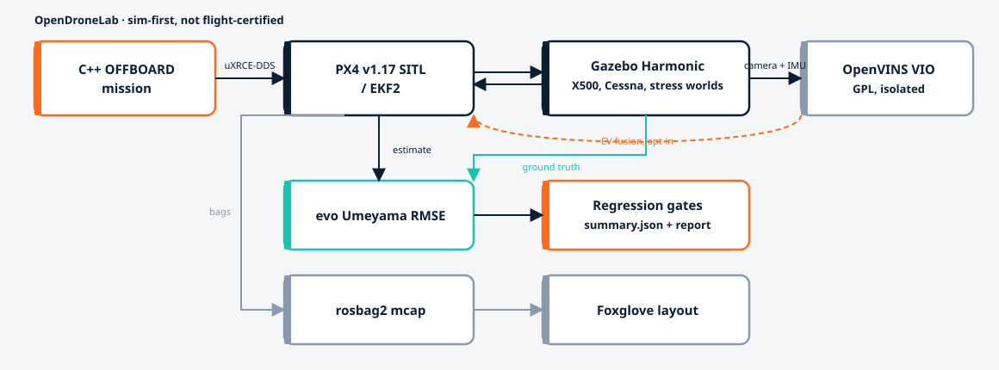
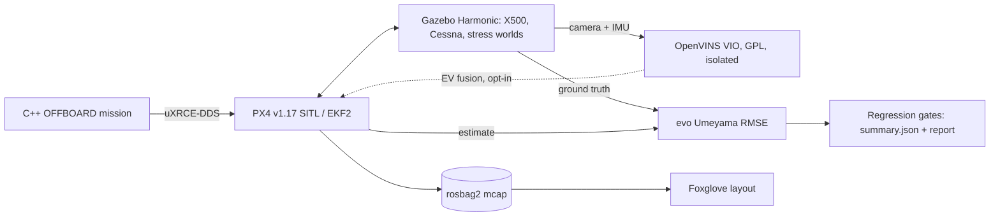

# Architecture

The editable source is [`docs/architecture.excalidraw`](https://github.com/palcode/opendronelab/blob/main/docs/architecture.excalidraw) in the repository. Teal marks ground truth; orange marks the opt-in EV fusion path and regression gates.

A C++ OFFBOARD mission talks to PX4 v1.17 SITL over uXRCE-DDS. Gazebo Harmonic provides the vehicle, worlds, camera, and ground truth. OpenVINS is built and run in isolation (GPL) and is scored in shadow unless vision fusion is opted in. Official metrics are a global evo Umeyama fit against ground truth. Bags are recorded as rosbag2 / mcap for review in Foxglove.

The longer in-tree guide is [architecture.md](architecture.md). Compatibility pins are in [compatibility-matrix.md](compatibility-matrix.md).
