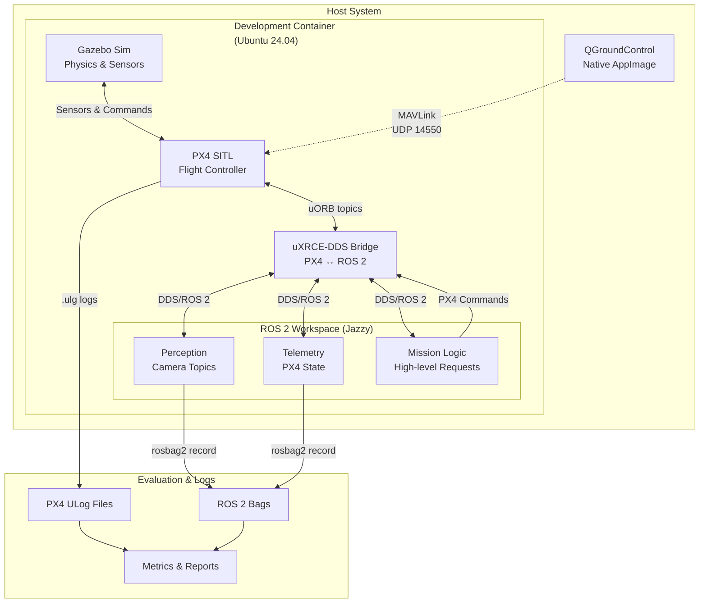

# OpenDroneLab Architecture

## Overview

OpenDroneLab is a modular software environment for developing and evaluating drone autonomy in simulation. The architecture follows a clear separation of concerns between flight control (PX4), simulation (Gazebo), middleware (uXRCE-DDS), and autonomy/perception (ROS 2).

## System Architecture Diagram



## Architecture Rules

These rules define the boundaries and responsibilities within the system:

### 1. Flight Control Authority
**PX4 remains responsible for low-level flight control and stabilization.**

- All attitude control, motor mixing, and stabilization happen in PX4
- Do not build a second low-level flight controller in ROS 2
- Do not bypass PX4's control loops
- ROS 2 sends high-level commands (position setpoints, velocity commands)
- PX4 translates high-level commands to motor outputs

**Rationale:** PX4 is a proven, safety-tested flight controller. Reimplementing its core functions would be redundant and error-prone.

### 2. ROS 2 as Companion Computer
**ROS 2 provides companion functions: perception, mission logic, and monitoring.**

- ROS 2 observes PX4 state via telemetry topics
- ROS 2 processes sensor data (cameras, LiDAR)
- ROS 2 makes high-level mission decisions
- ROS 2 sends goals and setpoints to PX4
- ROS 2 does NOT command individual motors or implement attitude control

**Rationale:** This mirrors real-world companion computer architectures (e.g., Nvidia Jetson on a drone).

### 3. Explicit Interfaces Only
**Use documented PX4 interfaces, explicit QoS, and documented coordinate frames.**

- All PX4 ↔ ROS 2 communication goes through uXRCE-DDS bridge
- Only topics listed in `dds_topics.yaml` are available
- Use px4_msgs package for message definitions
- Document coordinate frame transformations (NED ↔ ENU)
- Set explicit QoS policies (Best Effort vs. Reliable)
- No undocumented or internal PX4 topics

**Rationale:** Explicit interfaces prevent brittle coupling and ensure compatibility across PX4 versions.

### 4. Simulation-Only Fault Injection
**Keep all fault injection inside the simulator/test harness.**

- Faults are injected in Gazebo sensor plugins or test scenarios
- Never inject faults into real flight hardware paths
- Use PX4's failure injection framework (SYS_FAILURE_EN) in simulation
- Document all fault scenarios before implementation
- Faults must be reproducible and logged

**Rationale:** Safety. Fault injection is for testing failure modes, not for production hardware.

### 5. No Cloud Dependency for Safety
**Do not make safety-critical behavior depend on cloud connectivity.**

- Local autonomy must work without internet
- Cloud is for training, large-scale data processing, and model serving
- Failsafes and emergency behaviors are local
- Telemetry upload is optional, not required
- Model inference can use cloud, but with local fallback

**Rationale:** Network failures should not cause loss of vehicle control.

### 6. PX4 Failsafes Remain Active
**Do not disable or bypass PX4's built-in failsafes.**

- Low battery, GPS loss, and RC loss failsafes remain enabled
- ROS 2 nodes stopping should not cause crashes
- PX4 should enter safe mode (Hold, Land, RTL) on ROS 2 failure
- Test that PX4 failsafes work when ROS 2 nodes are killed
- Use PX4's existing failsafe mechanisms (COM_* parameters)

**Rationale:** PX4's failsafes are the last line of defense. ROS 2 is experimental; PX4 is safety-critical.

## Component Responsibilities

### PX4 SITL
- **Role:** Flight controller simulation
- **Inputs:** High-level commands (position/velocity setpoints), RC input, Gazebo sensor data
- **Outputs:** Motor commands, telemetry (attitude, position, battery, etc.)
- **Coordinate Frame:** NED (North-East-Down)
- **Communication:** uORB (internal), MAVLink (QGroundControl), uXRCE-DDS (ROS 2)

### Gazebo Harmonic
- **Role:** Physics simulation and sensor emulation
- **Provides:** World physics, vehicle dynamics, sensor data (IMU, GPS, camera, LiDAR, barometer)
- **Outputs:** Simulated sensor readings to PX4
- **Inputs:** Motor commands from PX4 (thrust/torque)
- **Note:** This is the ONLY source of sensor data in SITL

### uXRCE-DDS Bridge
- **Role:** Middleware between PX4 uORB and ROS 2 DDS
- **Components:**
  - **Client:** Runs on PX4 (embedded in firmware)
  - **Agent:** Runs on companion computer (host/container)
- **Transport:** UDP (default port 8888 for SITL)
- **Topics:** Defined in `dds_topics.yaml` in PX4 source
- **Function:** Bidirectional translation between uORB and DDS

### ROS 2 Workspace

#### drone_bringup
- Launch files and parameter YAML
- Coordinate all ROS 2 nodes
- Not created in Phase 0

#### drone_interfaces
- Custom message definitions (only if needed)
- Prefer using px4_msgs directly
- Not created in Phase 0

#### drone_telemetry
- Subscribe to PX4 state topics
- Monitor vehicle health and status
- Publish aggregated telemetry for higher-level nodes
- Not created in Phase 0

#### drone_mission_manager
- High-level mission state machine
- Sends position/velocity setpoints to PX4
- Handles mission abort and failover
- Not created in Phase 0

#### drone_perception
- Process camera and sensor data
- Object detection, segmentation, tracking
- Publish perception results for mission nodes
- Not created in Phase 0

#### drone_localization
- Experimental localization (VIO, sensor fusion)
- Compare against PX4 EKF2 estimates
- Evaluation-only (not control-loop)
- Not created in Phase 0

#### drone_evaluation
- Extract metrics from rosbags and PX4 logs
- Generate plots and reports
- Scenario configuration and replay
- Not created in Phase 0

### QGroundControl
- **Role:** Ground control station
- **Communication:** MAVLink over UDP (port 14550)
- **Purpose:** Manual control, mission upload, parameter tuning, monitoring
- **Note:** Independent of ROS 2; runs natively on host

## Data Flow

### Telemetry Flow (PX4 → ROS 2)
1. PX4 publishes uORB topics (e.g., `vehicle_local_position`, `vehicle_attitude`)
2. uXRCE-DDS client in PX4 forwards topics to agent
3. Agent publishes to ROS 2 DDS network
4. ROS 2 nodes subscribe (e.g., `/fmu/out/vehicle_local_position`)

### Command Flow (ROS 2 → PX4)
1. ROS 2 node publishes command (e.g., `TrajectorySetpoint`)
2. uXRCE-DDS agent receives DDS message
3. Agent forwards to uXRCE-DDS client in PX4
4. PX4 receives as uORB topic (e.g., `trajectory_setpoint`)
5. PX4 flight controller acts on command

### Sensor Flow (Gazebo → PX4)
1. Gazebo simulates sensors (IMU, GPS, camera, etc.)
2. Gazebo bridge publishes to PX4 (via gz topics)
3. PX4 consumes sensor data as if from real hardware
4. PX4 runs EKF2 fusion and publishes estimates

### Camera Flow (Gazebo → ROS 2)
1. Gazebo camera sensor publishes image
2. Images available to ROS 2 via Gazebo bridge
3. ROS 2 perception nodes subscribe to camera topics
4. Processed perception published back to ROS 2

## Coordinate Frames

### PX4 (NED - North-East-Down)
- X: North
- Y: East
- Z: Down (positive downward)
- Standard aviation convention

### ROS 2 (ENU - East-North-Up)
- X: East
- Y: North
- Z: Up (positive upward)
- Standard robotics convention

### Transformation
- Always use explicit frame transforms (tf2)
- Document frame IDs in all messages
- Use px4_ros_com utilities where available
- Test coordinate transformations with known positions

## Container-First Development Strategy

### Philosophy: Minimal Host, Maximal Isolation

**Host System (Minimal):**
- Ubuntu 26.04 LTS with native NVIDIA driver (595.99.02)
- Docker Engine + NVIDIA Container Toolkit
- QGroundControl AppImage (native for serial port access)
- Basic development tools (git, cmake, build-essential for repo management)
- Nothing else - keep the host clean

**Development Container (Ubuntu 24.04):**
- All PX4 toolchain and dependencies
- Gazebo Harmonic simulator
- ROS 2 Jazzy workspace
- Micro XRCE-DDS Agent
- Python environments for perception/evaluation
- Development tools isolated from host

### Why Container-First?

1. **Compatibility:** Ubuntu 26.04 not yet supported by PX4; container runs Ubuntu 24.04
2. **Isolation:** PX4 build dependencies don't pollute host system
3. **Reproducibility:** Container definition is version-controlled
4. **Portability:** Same container works on any Docker host
5. **Experimentation:** Destroy and rebuild containers without host reinstall
6. **Multiple Environments:** Run different PX4/ROS versions in separate containers

### Container Configuration

#### GPU Passthrough (NVIDIA)
```bash
docker run --gpus all ...
```
- Requires NVIDIA Container Toolkit on host
- Provides full GPU access for Gazebo rendering
- CUDA 13.2+ runtime in container images
- Verify with: `docker run --rm --gpus all nvidia/cuda:13.2.1-base-ubuntu24.04 nvidia-smi`

#### Display Forwarding (GUI Applications from Containers)

**Requirement:** Gazebo and other GUI applications from containers must display on host screen.

**Host Environment:**
- GNOME Wayland session
- Hybrid graphics: Intel iGPU + NVIDIA RTX 5060 dGPU
- XWayland provides X11 compatibility layer

**Recommended: X11 Socket Forwarding via XWayland**

```bash
# On host (one-time per session): Allow local user to access X server from containers
xhost +SI:localuser:$(whoami)

# To revoke access later:
# xhost -SI:localuser:$(whoami)

# In docker run command:
docker run \
  --user $(id -u):$(id -g) \
  -v /tmp/.X11-unix:/tmp/.X11-unix:ro \
  -e DISPLAY=$DISPLAY \
  --device /dev/dri:/dev/dri \
  --gpus all \
  -e __NV_PRIME_RENDER_OFFLOAD=1 \
  -e __GLX_VENDOR_LIBRARY_NAME=nvidia \
  ...
```

**Configuration Details:**

1. **User Mapping (REQUIRED for GUI):**
   - `--user $(id -u):$(id -g)` - Run container as current host user
   - Required for `xhost +SI:localuser:$(whoami)` authorization
   - Containers running as root will be rejected by X server
   - Ensures container files match host user ownership

2. **X11 Socket Mount:**
   - `-v /tmp/.X11-unix:/tmp/.X11-unix:ro` - Share X11 Unix socket (read-only)
   - `-e DISPLAY=$DISPLAY` - Pass display identifier (e.g., `:0`)
   - Works through XWayland on Wayland hosts

3. **GPU Access:**
   - `--gpus all` - NVIDIA Container Toolkit GPU passthrough
   - `--device /dev/dri:/dev/dri` - Intel iGPU DRI devices (for fallback)

4. **NVIDIA PRIME Render Offload:**
   - `-e __NV_PRIME_RENDER_OFFLOAD=1` - Force NVIDIA GPU rendering
   - `-e __GLX_VENDOR_LIBRARY_NAME=nvidia` - Use NVIDIA OpenGL library
   - Required on hybrid graphics systems to use dGPU instead of iGPU
   - Source: [NVIDIA PRIME Render Offload](https://download.nvidia.com/XFree86/Linux-x86_64/535.86.05/README/primerenderoffload.html)

5. **X11 Authorization:**
   ```bash
   xhost +SI:localuser:$(whoami)
   ```
   - Allows containers running as current user to connect to X server
   - Scoped to local user only (more secure than `+local:docker`)
   - Format: `SI:localuser:<username>` grants access for that specific user
   - **Critical:** Requires `--user $(id -u):$(id -g)` in docker run
   - **Revoke access:** `xhost -SI:localuser:$(whoami)` after work session
   - **Check current grants:** `xhost` (shows all access control entries)

**Verification Inside Container:**

```bash
# Verify DISPLAY is set
echo $DISPLAY

# Verify GPU is accessible
nvidia-smi

# Verify OpenGL renderer (should show NVIDIA GPU)
glxinfo | grep "OpenGL renderer"
# Expected: "OpenGL renderer string: NVIDIA GeForce RTX 5060 Laptop GPU/PCIe/SSE2"

# Test GUI application
xclock  # Simple X11 test
```

**Alternative: Wayland Socket (Experimental)**

```bash
docker run \
  -v $XDG_RUNTIME_DIR/$WAYLAND_DISPLAY:/tmp/$WAYLAND_DISPLAY:ro \
  -e WAYLAND_DISPLAY=$WAYLAND_DISPLAY \
  -e XDG_RUNTIME_DIR=/tmp \
  --device /dev/dri:/dev/dri \
  --gpus all \
  ...
```

- Native Wayland forwarding (no XWayland layer)
- **Status:** Experimental; Gazebo may not support Wayland yet
- **Recommendation:** Use X11 socket method above for now
- **Source:** [Wayland in Docker](https://wiki.archlinux.org/title/Wayland#GUI_applications_in_containers)

**Headless Mode (Optional Fallback)**

Use for automated evaluation runs when GUI is not needed:

```bash
# Inside container:
HEADLESS=1 make px4_sitl gz_x500

# Or set environment variable:
docker run -e HEADLESS=1 ...
```

- No Gazebo GUI, faster startup
- Simulation runs without rendering
- Reduced CPU/GPU usage
- Ideal for CI/CD pipelines and batch scenario evaluation

**Security Considerations:**

1. **xhost +SI:localuser:$(whoami):**
   - Allows containers running as current user to access X server
   - More secure than `+local:docker` (scoped to specific user, not all containers)
   - Safe for single-user development machines
   - **Do NOT use `xhost +`** (allows network access from anywhere)
   - **Do NOT use `xhost +local:docker`** (allows all local containers)
   - Revoke after work: `xhost -SI:localuser:$(whoami)`

2. **Alternative: .Xauthority forwarding (more secure):**
   ```bash
   docker run \
     -v /tmp/.X11-unix:/tmp/.X11-unix:rw \
     -e DISPLAY=$DISPLAY \
     -e XAUTHORITY=/tmp/.Xauthority \
     -v $HOME/.Xauthority:/tmp/.Xauthority:ro \
     --user $(id -u):$(id -g) \
     ...
   ```
   - Passes X11 authentication cookie
   - No xhost modification needed
   - May require matching UID/GID inside container

3. **Network Isolation:**
   - Host network mode (`--network host`) simpler for MAVLink/DDS
   - Bridge network mode more isolated but requires port mapping
   - For production, use bridge network with explicit ports

**Troubleshooting:**

| Issue | Solution |
|-------|----------|
| "cannot open display" | Run `xhost +SI:localuser:$(whoami)` on host; verify `DISPLAY` env var |
| Gazebo renders on Intel iGPU | Verify `__NV_PRIME_RENDER_OFFLOAD=1` is set; check `glxinfo` |
| Slow rendering | Ensure `--gpus all` is set; verify nvidia-smi shows GPU |
| Permission denied on X11 socket | Add `-v /tmp/.X11-unix:/tmp/.X11-unix:rw` (read-write) |
| Black screen in Gazebo | Update to NVIDIA base image with compatible CUDA (13.2+) |

**References:**
- [Docker and X11](https://wiki.ros.org/docker/Tutorials/GUI)
- [NVIDIA Container Toolkit](https://docs.nvidia.com/datacenter/cloud-native/container-toolkit/)
- [NVIDIA PRIME Render Offload](https://download.nvidia.com/XFree86/Linux-x86_64/535.86.05/README/primerenderoffload.html)

#### Networking

**Host Network (Recommended for Development)**
```bash
docker run --network host ...
```
- MAVLink (UDP 14550) directly accessible by host QGroundControl
- uXRCE-DDS (UDP 8888) accessible for multi-container setups
- ROS 2 DDS discovery works across host-container boundary
- Simplest setup for single-vehicle SITL

**Bridge Network (Alternative)**
```bash
docker run -p 14550:14550/udp -p 8888:8888/udp ...
```
- More isolated, explicit port mappings
- Useful for multi-container deployments
- Requires manual DDS discovery configuration

#### Volume Mounts

**Workspace (Development Files)**
```bash
-v $ODL_ROOT:/workspace
```
- Mount repository from host into container at `/workspace`
- Edit code on host with IDE (VSCode, vim, etc.)
- Build and run inside container
- Repository path on host: `$ODL_ROOT`

**PX4 Source (Optional, for development)**
```bash
-v $ODL_DATA/PX4-Autopilot:/opt/PX4-Autopilot
```
- The dev image already includes PX4 at `/opt/PX4-Autopilot`. Bind-mount a
  host checkout only if you are iterating on PX4 itself.
- Share one host checkout between containers to avoid re-cloning.

**Data (Logs, Bags, Datasets)**
```bash
-v $ODL_DATA:/data
```
- Persist logs and datasets outside container
- Survive container rebuilds
- Keep large files out of Git repository

### Container Lifecycle

#### Development Workflow
1. Start container with mounted workspace
2. Edit code on host with IDE
3. Build and test inside container
4. Logs/bags written to mounted volumes
5. Stop container when done

#### Container Rebuild
- When dependencies change: rebuild container image
- When Dockerfile changes: rebuild from scratch
- Workspace volume persists across rebuilds
- Fast iteration: don't rebuild for code changes

### QGroundControl: Native Host Installation

**QGroundControl runs natively on the host, NOT in a container.**

#### Why Native?

1. **Serial port access:** Direct access to `/dev/ttyUSB*`, `/dev/ttyACM*` for future hardware
2. **GUI integration:** Native GNOME window management, system tray integration
3. **Performance:** Direct GPU access, no X11 forwarding overhead
4. **Official support:** QGC AppImage designed for Ubuntu desktop
5. **User permissions:** Simple `dialout` group membership on host
6. **Persistence:** Settings survive container rebuilds

#### Installation (Proposed - Phase 1)

**Download:**
- Official AppImage from [QGroundControl Downloads](https://docs.qgroundcontrol.com/master/en/qgc-user-guide/getting_started/download_and_install.html)
- Architecture: x86_64 (Intel/AMD 64-bit)
- Location: `~/Applications/QGroundControl.AppImage` or `~/Downloads/`

**Prerequisites (Ubuntu 26.04):**
```bash
# Install AppImage dependencies
sudo apt install -y libfuse2t64 libxcb-xinerama0 libxkbcommon-x11-0 libxcb-cursor0

# Add user to dialout group (serial port access)
sudo usermod -aG dialout $USER

# Optional: Disable ModemManager if it interferes with serial ports
# Only needed if QGC cannot connect to serial devices
sudo systemctl mask --now ModemManager.service

# Make AppImage executable
chmod +x ~/Applications/QGroundControl.AppImage

# Logout and login for dialout group to take effect
```

**Source:** [QGC Ubuntu Install Guide](https://docs.qgroundcontrol.com/master/en/qgc-user-guide/getting_started/download_and_install.html)

#### MAVLink Connectivity from Containers

**Network Configuration:**

PX4 SITL in containers connects to QGroundControl via MAVLink over UDP.

**Default Ports:**
- **UDP 14550:** PX4 → QGroundControl (telemetry, heartbeat)
- **UDP 14540:** PX4 listen port (for multiple GCS instances)
- **UDP 18570:** Optional MAVLink 2 port

**Host Networking (Recommended):**

```bash
docker run --network host \
  --gpus all \
  -v /tmp/.X11-unix:/tmp/.X11-unix:rw \
  -e DISPLAY=$DISPLAY \
  ...
```

- PX4 SITL binds to `0.0.0.0:14550` (all interfaces)
- QGroundControl on host connects to `127.0.0.1:14550` (localhost)
- Automatic discovery via MAVLink heartbeat
- No port mapping needed
- Simplest configuration for development

**Bridge Networking (Alternative):**

```bash
docker run \
  -p 14550:14550/udp \
  -p 14540:14540/udp \
  --gpus all \
  ...
```

- Explicit port mapping: `-p <host-port>:<container-port>/udp`
- QGroundControl connects to `127.0.0.1:14550` on host
- More isolated than host networking
- Useful for multi-container setups with port conflicts

**Verification:**

```bash
# Inside container: Check PX4 MAVLink output
# PX4 logs should show:
# INFO  [mavlink] mode: Normal, data rate: 4000000 B/s on udp port 14550 remote port 14550

# On host: QGroundControl should auto-connect
# QGC status bar shows: "Connected to Vehicle 1"
```

**Connection Flow:**

```
┌─────────────────────────────────────────────┐
│  Host (Ubuntu 26.04)                        │
│  ┌───────────────────────────────────────┐  │
│  │  QGroundControl (Native AppImage)     │  │
│  │  Listening on UDP 0.0.0.0:14550       │  │
│  └──────────────▲────────────────────────┘  │
│                 │ MAVLink UDP               │
│                 │ 127.0.0.1:14550           │
│  ┌──────────────┴────────────────────────┐  │
│  │  Container (--network host)           │  │
│  │  ┌──────────────────────────────────┐ │  │
│  │  │  PX4 SITL                        │ │  │
│  │  │  Sending to 127.0.0.1:14550      │ │  │
│  │  └──────────────────────────────────┘ │  │
│  └───────────────────────────────────────┘  │
└─────────────────────────────────────────────┘
```

#### QGC Configuration

**Default Settings (No Changes Needed):**
- UDP Port: 14550
- Auto-connect: Enabled
- MAVLink version: 2.0

**Advanced (Optional):**
- Application Settings → Comm Links → Add new UDP connection
- Host Address: `127.0.0.1` (or leave blank for any)
- Port: `14550`
- Auto-connect on start: Enabled

#### Real hardware

Bring-up checklist and launch hooks: `docs/real-drone-readiness.md`. Do not invent serial devices or airframe IDs here.

## Deployment Strategy

### Phase 1: Local SITL
- Single PX4 SITL instance
- Gazebo on same machine
- ROS 2 nodes in same container
- QGroundControl on host

### Multi-host / distributed (future exploration)

Not implemented. Single-host container + host QGC is the supported layout.

### Not in Scope (Yet)
- Real hardware flight
- Multi-vehicle swarms
- Hardware-in-the-loop (HIL)
- ROS 2 Zenoh bridge (Experimental in PX4 v1.17+)

## Testing Strategy

### Unit Tests
- ROS 2 nodes: pytest, gtest
- C++ utilities: gtest
- Python utilities: pytest

### Integration Tests
- PX4 SITL + Gazebo + ROS 2 together
- Verify topics published/subscribed
- Verify commands reach PX4
- Verify PX4 failsafes trigger correctly

### Scenario Tests
- Defined in YAML (scenario config)
- Reproducible launch
- Automated metric extraction
- Pass/fail criteria

### Fault Injection Tests
- Gazebo sensor faults (GPS loss, IMU noise, camera dropout)
- PX4 SYS_FAILURE_EN framework
- Verify system degrades gracefully
- Verify PX4 failsafes activate

## Logging and Evaluation

### PX4 Logs (.ulg)
- PX4's internal binary log format
- Contains all uORB topics
- Analyzed with pyulog, PlotJuggler
- Source of truth for PX4 state

### ROS 2 Bags (rosbag2)
- ROS 2's mcap format
- Contains ROS 2 topics
- Analyzed with rosbag2 CLI, PlotJuggler
- Source for ROS 2 node behavior

### Metrics
- Extracted from logs via Python
- Position/attitude error vs. ground truth
- Latency measurements
- Failsafe trigger times
- CSV output for plotting

### Reports
- Generated Markdown with plots
- Scenario description, results, pass/fail
- Stored in `evaluation/reports/`

## Security and Safety Considerations

### Simulation-Only Disclaimer
- This is a simulation-only environment
- No real flight hardware is involved
- Safety checks are minimal (not flight-ready)

#### Real hardware

Bring-up checklist and launch hooks: `docs/real-drone-readiness.md`. Do not invent serial devices or airframe IDs here.

### Data Privacy
- No telemetry uploaded without explicit user consent
- Local-only operation by default
- No embedded credentials in repo

### Supply Chain
- All dependencies from official sources
- Docker images from official registries
- Pin versions for reproducibility
- Regular security updates

## Repository Structure

```
open-drone-lab/
├── README.md                  # Project overview
├── docs/                      # Documentation
│   ├── AGENTS.md              # AI agent working agreement
│   ├── architecture.md        # This file
│   ├── compatibility-matrix.md
│   ├── setup-host.md
│   ├── setup-container.md     # (Phase 1)
│   ├── simulation-guide.md    # (Phase 1)
│   ├── ros2-integration.md    # (Phase 2)
│   ├── safety-and-limitations.md
│   └── decisions/             # Architecture decision records
├── docker/                    # Container definitions
│   ├── Dockerfile             # (Phase 1)
│   ├── compose.yaml           # (Phase 1)
│   └── entrypoint.sh          # (Phase 1)
├── scripts/                   # Utility scripts
│   ├── check-host.sh          # Phase 0 ✓
│   ├── build-workspace.sh     # (Phase 2)
│   ├── launch-sitl.sh         # (Phase 1)
├── simulation/                # Gazebo assets
│   ├── worlds/                # Custom worlds (Phase 3+)
│   ├── models/                # Custom models (Phase 3+)
├── ros2_ws/                   # ROS 2 workspace (Phase 2)
│   └── src/
│       ├── drone_bringup/
│       ├── drone_interfaces/
│       ├── drone_telemetry/
│       ├── drone_mission_manager/
│       ├── drone_perception/
│       ├── drone_localization/
│       └── drone_evaluation/
│   ├── baseline/
│   ├── sensor_quality/
│   └── communication/
│   ├── metrics/
│   ├── plots/
│   └── reports/
└── data/                      # Datasets (gitignored)
```

## Versioning and Change Management

### Version Pinning
- PX4: Pin to stable release tag (e.g., `v1.17.2`)
- ROS 2: Use LTS release (Jazzy)
- Gazebo: Installed by PX4 setup (Harmonic default)
- Docker base images: Pin to specific tags
- Python packages: Pin in requirements.txt

### Architecture Decision Records (ADRs)
- Document major design choices in `docs/decisions/`
- Format: `NNNN-title.md` (e.g., `0001-use-ubuntu-24-container.md`)
- Include context, decision, consequences

### Git Workflow
- Feature branches for new capabilities
- Main branch for stable, tested code
- Tag releases (v0.1.0, v0.2.0, etc.)
- Never commit large bags, logs, or binaries

## Future exploration

Unscheduled ideas (image rebuild, CI, Lyrical/Jetty, alternate sim frameworks) live in `docs/evaluation-roadmap.md`. Real hardware bring-up is first-class: `docs/real-drone-readiness.md`.


## References

- PX4 Architecture: https://docs.px4.io/main/en/concept/architecture.html
- ROS 2 Architecture: https://docs.ros.org/en/jazzy/Concepts.html
- uXRCE-DDS: https://micro-xrce-dds.docs.eprosima.com/
- Gazebo Architecture: https://gazebosim.org/docs/
