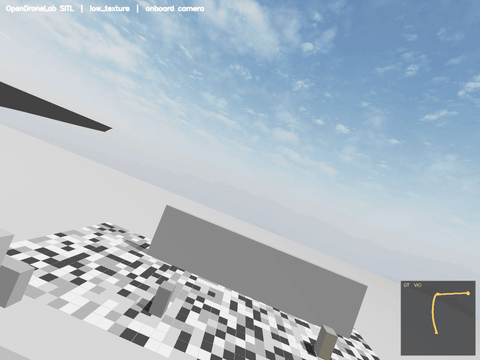

# OpenDroneLab

{ class="logo" }

{ class="logo" }

From git clone to a scored autonomous flight in one command.

PX4 v1.17 · ROS 2 Jazzy · Gazebo Harmonic · all in Docker

{ class="demo" }

**Scored, not just simulated.** Every official flight is graded against Gazebo ground truth (evo Umeyama RMSE) with regression gates that fail loudly.

**Current stack, in Docker.** PX4 v1.17 SITL, ROS 2 Jazzy, and Gazebo Harmonic in one development image, a C++ OFFBOARD node, optional OpenVINS VIO, and VIO stress worlds.

**Sim-first, not flight-certified.** The verified path today is software-in-the-loop. Do not use this project to operate a real aircraft without a separate safety, legal, and range review.

- [Quickstart](quickstart.md) — clone, build the image, run headless tests or a scored SITL suite
- [Architecture](architecture-overview.md) — OFFBOARD, PX4, Gazebo, isolated OpenVINS, and gates
- [Scenarios and benchmarks](benchmarks.md) — official worlds and documented results
- [RMSE gates](rmse-gates.md) — the numbers that must not be loosened silently
- [Roadmap](roadmap.md) — now / next / later, built in public
- [Contributing](contributing.md) — good first issues, CLA, and house rules
- [Licensing](licensing.md) — AGPL-3.0-only, with a commercial option

The source repository is [palcode/opendronelab](https://github.com/palcode/opendronelab). This site is a draft; GitHub Pages is not enabled until the maintainer agrees.
